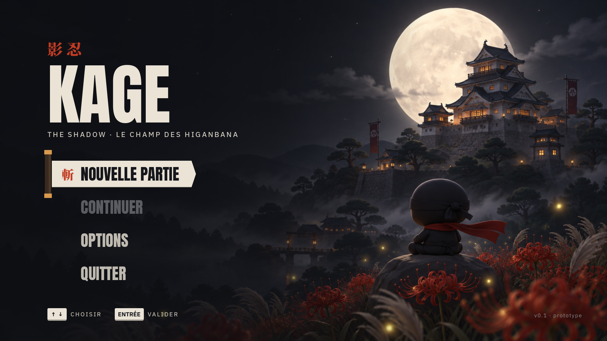

# KAGE

Jeu d'infiltration ninja en 3D, style chibi. Le joueur se faufile de nuit, du village au palais du seigneur, sans se faire repérer par les gardes.

Projet scolaire, réalisé avec Godot 4 et publié en version web sur itch.io.

## Ouvrir le projet

1. Installer [Godot 4.4 ou plus](https://godotengine.org/download) (version standard, pas .NET).
2. Dans Godot : **Importer**, puis choisir `project.godot`.
3. Lancer avec **F5**.

## Commandes

| Action | Touches |
| --- | --- |
| Se déplacer | ZQSD (ou WASD) / flèches |
| Sauter | Espace |
| Courir | Maj (Shift) |
| S'accroupir | Ctrl ou C |
| Coup de katana | L ou clic gauche (vers la souris) |
| Sortir ou ranger le katana | P |
| Passer le dialogue | Entrée (Échap pour tout passer) |
| Ouvrir une porte ou le coffre | E |
| Pause | Échap |

Les touches sont réglées par position physique, donc ZQSD sur un clavier AZERTY et WASD sur un QWERTY.

## Écrans

- **Menu principal** (`scenes/ui/menu.tscn`, scène de départ) : Nouvelle partie lance le jeu avec un fondu, Continuer s'active quand une sauvegarde existe, Options règle les volumes (général, musique, bruitages), la qualité (Rapide, Normale, Haute) et le plein écran, Quitter est masqué dans la version web.
- **Le niveau** (`scenes/levels/chateau.scn`) : lancé par Nouvelle partie, avec un écran de chargement. Un seul grand niveau :
  - **Cinématique d'ouverture** (Échap pour la passer) : on survole le château, puis le maître Kagemaru parle à Kage dans sa cabane (boîte de dialogue moderne, sans voix).
  - **Le village de la forêt** : cabanes en bois aux toits rouges, chemin de terre, 8 villageois qui vivent leur journée (balayer, porter du bois, pêcher, discuter, jouer) et saluent Kage, avec juste leur nom au-dessus de la tête, chats, ruisseau et pont rouge, étang aux carpes, guirlandes de lanternes 福, lucioles, gros buissons où se cacher.
  - **Le château** : on ouvre la grande porte (E), puis on traverse les cours. Les gardes portent des lanternes : leur lumière jaune devient orange puis rouge quand ils te repèrent.
  - **Le boss** : en entrant dans le donjon, la porte du donjon claque derrière Kage, le seigneur Oni se dresse et rugit, puis attaque. Il charge (esquive, puis frappe quand il souffle) et frappe le sol (saute par-dessus l'onde). 8 coups pour le vaincre.
  - **Le coffre** : il apparaît après le combat. On l'ouvre (E) et Kage brandit le parchemin bien haut de la main droite, puis on fuit par le rempart est.
- **Terrain d'essai** (`scenes/jeu.tscn`) : terrain de test à l'échelle chibi : muret (0,9 m), caisse, maison (1,9 m) et rempart (2,2 m). Échap ramène au menu.

## Le ninja

`scenes/characters/ninja.tscn` et `scripts/ninja.gd`.

Modèles 3D : le ninja et le garde ont été générés avec TRELLIS (trellis3d.net) à partir des planches.
Les fichiers sont utilisés tels quels (`assets/models/ninja.glb`, `garde.glb`) : les scènes
`*_modele.tscn` règlent seulement la taille et la position, et l'import ignore les lumières du fichier.
`scripts/anim_chibi.gd` leur donne un petit rebond en marchant.
Ambiance : il pleut sur tous les niveaux (`scripts/pluie.gd`, retirée pour l'instant : gouttes et éclaboussures
autour du ninja) et des esprits bleus (flammes hitodama, feux de renard ou petits fantômes) passent puis s'effacent (`scripts/esprits.gd`, sans collision).
Des taches de fleurs des champs couvrent l'herbe libre, avec des coins de jardin (pierres moussues,
buissons taillés, pas japonais, petits sanctuaires). Autour des niveaux : forêt de cèdres, pins et bambous,
montagnes au loin et ciel de nuit dessiné (`assets/shaders/ciel.gdshader` : lune, étoiles, nuages).
Les allées ont des bordures de pierre et des flaques (`flaque.gdshader`) ; les autels sont de petits sanctuaires.

Le ninja est **riggé** : `scripts/tools/articuler.gd` lui pose un squelette de 14 os (bassin, ventre,
poitrine, tête, bras, avant-bras, cuisses, tibias, pieds) sans toucher à son apparence (mêmes sommets, même
texture), puis crée ses animations clés dans `assets/models/ninja_animations.res` : repos, course, marche
accroupie, accroupi immobile, saut, chute, atterrissage, coup de katana et escalade. `anim_chibi.gd` choisit l'animation selon
le mouvement et fait les fondus entre elles. Pour le refaire (le chemin final exporte aussi un `.glb`
ouvrable dans Blender) :
`xvfb-run -a godot --rendering-driver opengl3 --path . --script res://scripts/tools/articuler.gd -- ninja_rig.glb`.

- Marche à 5,5 m/s, course à 8,5 m/s (Maj), accroupi à 2,2 m/s.
- Saut d'environ 1,2 m : assez pour monter sur un muret.
- En sautant contre un mur ou un toit jusqu'à 2,4 m, il s'accroche et se hisse dessus.
- Coup de katana (L) devant lui, vers la souris : il tranche les gardes à moins de 1,7 m. Le sabre est rangé dans son fourreau, dans le dos : P le sort ou le range, et L le sort tout seul s'il est rangé.
- 3 points de vie : chaque coup de garde en retire un (le ninja est repoussé et clignote un instant). À 0, il repart du dernier autel.
- Un coup de katana (L) sur une lanterne allumée l'éteint.
- Les gardes sont riggés eux aussi (`articuler.gd -- garde`) : repos, marche, course et coup de lance.
- Tous les réglages sont modifiables dans l'inspecteur de Godot.



## Dossiers

| Dossier | Contenu |
| --- | --- |
| `scenes/` | Scène principale, niveaux (`levels/`), interface (`ui/`), personnages (`characters/`) |
| `scripts/` | Scripts GDScript |
| `assets/models/` | Modèles 3D (.glb) |
| `assets/textures/` | Textures |
| `assets/audio/` | Musiques et bruitages |
| `assets/fonts/` | Polices de la charte : Anton, IBM Plex Sans JP, Noto Serif JP |
| `assets/ui/` | Éléments d'interface (parchemins, sceaux) |
| `docs/` | Notes pour le rapport |

## Réglages

- Scripts globaux : `Transition` (fondu entre écrans), `Reglages` (volume, plein écran), `Sauvegarde`.

- Affichage en 1920 × 1080, adapté à la taille de la fenêtre.
- Rendu « Compatibility », le seul qui marche dans le navigateur.
- Export **Web** prêt dans `export_presets.cfg`, sortie dans `build/web/`.
- Caméra haute et dézoomée, orientée plein nord, qui suit le ninja (`scripts/follow_camera.gd`).
- Couleurs de la charte dans `scripts/palette.gd`, thème Godot (polices et styles) dans `assets/ui/kage_theme.tres`. Détails dans [docs/design.md](docs/design.md).

## Les niveaux

Chaque niveau est généré par un script (1 px du plan = 4 cm). Le château suit le plan Figma « Le château » ; le village de la forêt est dessiné directement dans le script. Les outils communs sont dans `scripts/tools/constructeur.gd`, le décor d'ambiance dans `scripts/tools/decor.gd`.

```
godot --path . -- --construire=res://scripts/tools/build_chateau.gd
```

(Lancé ainsi, avec une fenêtre, pour que les scripts globaux et les MultiMesh du décor soient bien enregistrés.)

### Décor d'ambiance (ticket 4.4)

Murs blancs à soubassement de pierre, fenêtres à barreaux et toits de tuiles, bâtiments à colombages avec shoji éclairés,
lanternes en pierre (tōrō) et sur poteau qui vacillent avec leur halo, pins taillés et cerisiers en fleurs qui perdent
leurs pétales, gazon et herbes hautes qui ondulent, buissons, bambous, higanbanas, eau animée avec carpes koï, nénuphars
et berges de galets, cascades, ruisseau, ponts rouges, bannières au mon du clan, braseros, palissade en rondins, rizières,
jardin zen ratissé, lucioles et brume. Les matières sont dessinées par un shader (`assets/shaders/matiere.gdshader`),
dans un style doux et coloré ; seuls les rochers viennent d'un pack (Kenney, CC0, voir [CREDITS.md](CREDITS.md)). Le décor n'a pas de collision (sauf les gros rochers) : il ne change pas le jeu.

On peut ensuite retoucher les scènes dans Godot, mais une nouvelle génération écrase les retouches : mieux vaut modifier le script. Le titre, les textes et le niveau suivant se règlent au début de chaque script.

- **Gardes** (`scripts/garde.gd`) : ronde ou faction, cône de vision rouge au sol. Ils voient à 7,3 m si tu es éclairé, à 2 m dans la pénombre. Un garde qui te voit assez longtemps te **prend en chasse** et appelle les gardes proches : sème-le (il court moins vite que toi), cache-toi ou tranche-le au katana. S'il te rattrape, il frappe : tu perds un point de vie.
- **Planchers rossignol** (`scripts/rossignol.gd`, lattes claires) : ils grincent si tu marches debout, et les gardes proches viennent voir. Accroupi, tu passes sans bruit.
- **Guirlandes de lanternes** rouges et blanches (chōchin) au-dessus des allées, à la place des fils à clochettes. Purement décoratives.
- **Toits japonais** sur les bâtiments du parchemin (maison du chef, donjon à deux étages, salle du seigneur) : ils pâlissent quand le ninja approche et disparaissent quand il entre (`scripts/toit.gd`).
- **Intro** : le jeu commence dans une cabane, où le maître Kagemaru explique la mission (`scripts/dialogue.gd`).
- **Esprits bleus** (hitodama) : ils passent près du ninja et s'enfuient quand il approche.
- **Se cacher** (`scripts/zone.gd`) : ombre des arbres, herbes hautes (accroupi). La lumière des lanternes et le clair de lune te trahissent, comme la lune sur les toits.
- **Lanternes** : E les éteint, et le garde le plus proche vient voir.
- **Lune** : des nuages passent toutes les 14 s et coupent le clair de lune pendant 5 s.
- **Autels** : points de reprise. **Parchemin** dans le donjon, **sortie** dans le rempart est.
- Fin de partie : temps, bonus Fantôme (jamais repéré) et Pacifiste (aucun garde tué).

## Interface en jeu

D'après les maquettes HUD et les écrans du Figma :

- **HUD** (`scripts/hud.gd`) : œil et jauge de visibilité (CACHÉ, EXPOSÉ, REPÉRÉ, DÉCOUVERT), lune qui pâlit quand les nuages la cachent, parchemin 0 / 1, 3 cœurs de vie (flash rouge quand on est touché), invite « E · Trancher la lanterne », marqueurs ? et ! au-dessus des gardes méfiants ou alertés, bords rouges quand on est vu.
- **Écrans** (`scripts/ecrans_jeu.gd`, parchemins dessinés par `scripts/rouleau.gd`) : tutoriel au départ, pause (Échap : reprendre, recommencer à l'autel, quitter), défaite (R pour repartir de l'autel) et victoire avec le score (temps, Fantôme, Pacifiste ; Entrée pour le menu, R pour rejouer).
- 3 points de vie : à 0, tu repars du dernier autel, autant de fois qu'il le faut.

## Captures

```
godot --path . -- --capture=res://scenes/ui/menu.tscn --sortie=capture.png
```

## Design

Maquettes et charte graphique sur Figma : https://www.figma.com/design/PuRaFypYJ9RKAvVU2PYy2m

## Sons

Les musiques et bruitages (`assets/audio/`) sont joués par le script global `Sons` (`scripts/sons.gd`) :
musique douce au koto en jeu, tambours taiko quand un garde te poursuit. Ils sont tous créés par synthèse :

```
python3 scripts/tools/generer_sons.py
```

Détails et crédits dans [CREDITS.md](CREDITS.md).
