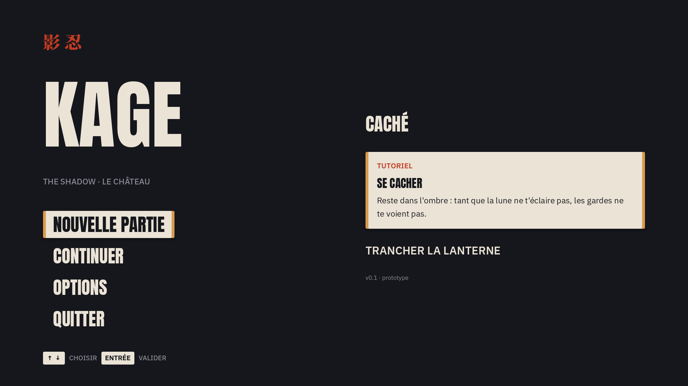

# Design : du Figma à Godot

Source : [Figma KAGE](https://www.figma.com/design/PuRaFypYJ9RKAvVU2PYy2m), page **Charte**.

## Couleurs

Dans `scripts/palette.gd` (`Palette.ENCRE`, `Palette.LAQUE`…).

| Nom | Hex | Usage |
| --- | --- | --- |
| Encre | `#16171C` | Fonds, texte sur parchemin |
| Ardoise | `#4B5160` | Ciel, brouillard, lumière ambiante |
| Washi | `#EAE3D6` | Texte principal, parchemins |
| Laque | `#C23B22` | Sceaux, kanji, alertes |
| Or | `#D99A4E` | Bouts de rouleau, détails |
| Gris | `#8E8F96` | Textes secondaires |
| Noir | `#0E0F12` | Voiles, ombres |
| Lune | `#DED0C9` | Lumière de lune |

## Polices

Dans `assets/fonts/`, toutes sous licence libre OFL (fichiers `OFL-*.txt`).
Elles sont réduites aux caractères utilisés pour que le jeu web charge vite.

| Police | Usage |
| --- | --- |
| Anton | Titres, boutons du menu, HUD |
| IBM Plex Sans JP | Tout le reste (textes, aides, consignes) |
| Noto Serif JP Black | Kanji décoratifs uniquement (影 忍 斬 巻 休…) |

Pour ajouter un kanji : refaire le sous-ensemble de Noto Serif JP avec `pyftsubset`.

## Thème Godot

`assets/ui/kage_theme.tres` est le thème par défaut du projet. Il est généré par
`scripts/tools/build_theme.gd` :

```
godot --headless --script res://scripts/tools/build_theme.gd
```

Styles disponibles (champ **Theme Type Variation** d'un nœud) :

| Variation | Base | Figma |
| --- | --- | --- |
| `TitreLogo` | Label | KAGE, Anton 210 |
| `TitreEcran` | Label | PAUSE, Anton 140 |
| `TitreHud` | Label | CACHÉ, Anton 51 |
| `TitreParchemin` | Label | SE CACHER, Anton 32 |
| `SousTitre` | Label | THE SHADOW, Plex Medium 22 |
| `Consigne` | Label | TRANCHER LA LANTERNE, Plex SemiBold 30 |
| `TexteParchemin` | Label | textes des tutoriels, Plex 22 |
| `Etiquette` | Label | TUTORIEL, Plex SemiBold 20 en laque |
| `Aide` / `Touche` | Label | CHOISIR / ENTRÉE, Plex 18 |
| `Version` | Label | v0.1, Plex 16 |
| `Kanji` / `KanjiFond` | Label | 影 忍 / grand 休 en fond |
| `BoutonMenu` | Button | boutons du menu, parchemin au survol |
| `Parchemin` | PanelContainer | tutoriels et dialogues |
| `Voile` | PanelContainer | fond sombre de la pause |
| `ToucheCadre` | PanelContainer | touche de clavier |

Aperçu : `scenes/ui/apercu_charte.tscn`.



## Images

Les images générées (fond du menu, planches) viennent de Figma. Elles ont un
réglage d'export PNG : **Fichier › Exporter** dans Figma, puis les déposer dans
`assets/ui/` (fond du menu : `assets/ui/menu_fond.png`).
